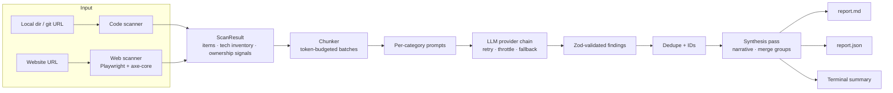

# ajc-dev code auditor

An LLM-powered auditor for **codebases** (local directories or git URLs) and **live websites / web apps**. It collects material deterministically (files, pages, headers, DOM, console errors, axe-core results), sends it to an external LLM in token-budgeted batches, and produces a structured report covering:

| Category | What it looks for |
|---|---|
| `security` | Injection, authn/authz flaws, secrets in source, insecure headers/cookies, outdated patterns (CWE/OWASP references) |
| `quality` | Maintainability, error handling, dead code, duplication, test gaps |
| `performance` | Hot-path inefficiencies, N+1 queries, blocking I/O, bundle/render issues |
| `accessibility` | WCAG violations (web targets only; axe-core results are fed to the model) |
| `architecture` | Layering, coupling, dependency direction, scalability concerns |
| `technology` | A summary of languages, frameworks, infrastructure and services in use |
| `ownership` | **Special notices** of anything indicating who authored or owns the code: copyright lines, LICENSE holders, `@author` tags, CODEOWNERS, git history, `humans.txt`, `security.txt`, JSON-LD publisher data |
| `custom` | Your own project rules, supplied as a plain-text/Markdown file |

Reports are written as **Markdown** (human-readable) and **JSON** (machine-readable, `schemaVersion: 1`), with a colour summary printed to the terminal.

The default LLM is **Google Gemini's free tier**, which needs no credit card. Four other free options (Groq, OpenRouter, Mistral, local Ollama) are preconfigured as drop-in alternatives and can be chained as automatic fallbacks. See [Free LLM providers](#free-llm-providers-default-and-fallbacks).

---

## Contents

- [How it works](#how-it-works)
- [Prerequisites](#prerequisites)
- [Installation](#installation)
- [Quick start](#quick-start)
- [Running an audit](#running-an-audit)
  - [Auditing a codebase](#auditing-a-codebase)
  - [Auditing a live website](#auditing-a-live-website)
  - [Checking provider setup](#checking-provider-setup)
  - [All command-line flags](#all-command-line-flags)
  - [Exit codes](#exit-codes)
- [Understanding the output](#understanding-the-output)
- [Configuration](#configuration)
- [Free LLM providers (default and fallbacks)](#free-llm-providers-default-and-fallbacks)
- [Custom rules](#custom-rules)
- [Privacy and cost](#privacy-and-cost)
- [Troubleshooting](#troubleshooting)
- [Development](#development)
- [Further reading](#further-reading)

---

## How it works



1. **Scan.** For code, files are collected with `.gitignore` and built-in ignores applied, binaries skipped, and the most informative files (manifests, configs, entry points) prioritised when the `maxFiles` cap bites. Git history yields author statistics. For websites, a headless Chromium performs a same-origin breadth-first crawl, capturing a text digest of each page's DOM, response headers, cookies, console errors, outbound requests, and axe-core violations. Both scanners also run **deterministic** detectors for technology (frameworks, servers, CMSs, analytics) and ownership (copyright, licenses, authors, organisations).
2. **Analyse.** Items are packed into batches that fit the configured token budget. Each enabled category sends its own prompt per batch, asking for findings in a strict JSON shape. Responses are parsed tolerantly (code fences, truncated output and stray prose are handled), validated, and given stable ids like `SEC-003`.
3. **Synthesise.** One final request writes the executive summary, architecture/technology/ownership narratives, top risks, and proposes cross-batch duplicate groups to merge. If that request fails, a deterministic narrative is generated instead so the report is always complete.
4. **Report.** The same `AuditReport` object is rendered to Markdown, JSON, and the terminal.

A deeper walkthrough of the modules is in [`docs/ARCHITECTURE.md`](docs/ARCHITECTURE.md).

---

## Prerequisites

| Requirement | Notes |
|---|---|
| **Node.js 20+** | Node 22 or 24 recommended. Check with `node --version`. |
| **pnpm** | `corepack enable && corepack prepare pnpm@latest --activate`, or `npm i -g pnpm`. npm/yarn also work if you prefer. |
| **git** | Only needed to audit remote repositories by URL. |
| **Chromium for Playwright** | Only needed for `audit web`. Installed with `pnpm playwright:install` (about 150 MB). |
| **An LLM API key** | A free Gemini key is enough. Not needed for `--dry-run`. |

---

## Installation

```bash
git clone https://github.com/aubreyjcook/ajc-dev_code-auditor.git
cd ajc-dev_code-auditor
pnpm install

# Only if you intend to audit websites:
pnpm playwright:install
```

You can run the tool straight from source with `pnpm audit ...` (uses `tsx`), or build it once and use the `audit` binary:

```bash
pnpm build            # emits dist/
node dist/cli.js --help
# or link it globally:
pnpm link --global    # now `audit --help` works anywhere
```

Examples below use `pnpm audit`; substitute `audit` if you linked it.

> Note: `pnpm audit` is also the name of pnpm's built-in dependency vulnerability command. Because this project defines an `audit` script, pnpm runs **our** script. If you ever want pnpm's own audit here, run `pnpm exec pnpm audit` or `npx pnpm audit`.

---

## Quick start

**1. Get a free Gemini API key** (about one minute, no card required):

- Visit <https://aistudio.google.com/apikey>, sign in with a Google account, click **Create API key**.

**2. Put the key in `.env`:**

```bash
cp .env.example .env
# edit .env and set:
# GEMINI_API_KEY=AIza...
```

(Or export it in your shell: `export GEMINI_API_KEY=AIza...` on macOS/Linux, `$env:GEMINI_API_KEY="AIza..."` in PowerShell.)

**3. Confirm the connection:**

```bash
pnpm audit providers
```

You should see `gemini` marked `ready` and `<- active`, followed by `Pinging gemini... ok`.

**4. Audit something:**

```bash
# the current directory
pnpm audit code .

# a public repository
pnpm audit code https://github.com/expressjs/express

# a website (after pnpm playwright:install)
pnpm audit web https://example.com
```

Reports land in `./audit-output/<timestamp>-<target>/report.md` and `report.json`.

**No key yet?** Exercise the whole pipeline offline:

```bash
pnpm audit code . --dry-run
```

`--dry-run` swaps in a deterministic mock provider; the findings are placeholders, but the scanners, chunker, report writers and terminal output are real.

---

## Running an audit

### Auditing a codebase

```bash
pnpm audit code <path-or-git-url> [options]
```

`<path-or-git-url>` may be:

- a local directory (`.`, `../my-service`, `C:\src\app`), or
- a git URL (`https://github.com/org/repo.git`, `git@github.com:org/repo.git`, `https://gitlab.com/org/repo`). The repository is shallow-cloned to a temporary directory, audited, and the clone deleted. Credentials embedded in the URL are redacted from the report.

What is collected:

- Text files not excluded by `.gitignore` (root and nested), built-in ignores (`node_modules`, `dist`, `build`, `.git`, lockfiles, minified bundles, images, archives, etc.), `--exclude`, or `--include`.
- Files larger than `--max-file-bytes` (default 200 KB) are skipped.
- When more than `--max-files` (default 400) remain, files are ranked: dependency manifests > infra/CI/config > entry points > application source > tests > docs, and the lowest-ranked files are dropped. Dropped files are listed in the report's "Skipped" section.
- Git metadata when the directory is a repository: remote URL, branch, commit, and author statistics (commit counts, first/last dates).

Useful variations:

```bash
# Only security and ownership, write to a custom folder
pnpm audit code . -c security,ownership -o ./reports

# Restrict to backend source, exclude generated code
pnpm audit code . --include "src/**/*.ts" --exclude "src/generated/**"

# Larger project: raise caps, use a faster free provider with a fallback chain
pnpm audit code ../big-monorepo --max-files 800 -p groq --fallback gemini,openrouter

# Enforce project rules, fail CI on high+ findings, JSON only
pnpm audit code . -r ./examples/custom-rules.md --fail-on high --format json

# Fully local and private with Ollama
pnpm audit code . -p ollama -m qwen2.5-coder:14b --concurrency 2
```

### Auditing a live website

```bash
pnpm audit web <url> [options]
```

The crawler starts at `<url>` (scheme defaults to `https://`) and follows same-origin links breadth-first up to `--max-pages` (default 10) and `--max-depth` (default 2). For every page it captures:

- a compact text digest of the rendered DOM (headings, landmarks, forms, scripts, links, meta tags),
- response status and headers (security headers are highlighted), cookies and their flags,
- console errors and failed network requests,
- third-party request hosts (analytics, CDNs, fonts),
- axe-core accessibility violations (disable with `--no-axe`),
- technology fingerprints (server, framework, CMS, generator, JS globals, analytics tags),
- ownership signals (footer copyright, `<meta name="author">`, JSON-LD `Organization`/`publisher`, `mailto:` links, `/.well-known/security.txt`, `/humans.txt`, `/robots.txt`).

Examples:

```bash
# Default crawl
pnpm audit web https://staging.example.com

# Deeper crawl, longer per-page timeout, watch the browser
pnpm audit web https://app.example.com --max-pages 30 --max-depth 3 --timeout 60000 --no-headless

# Accessibility and security only
pnpm audit web https://example.com -c accessibility,security

# Local dev server (http is fine)
pnpm audit web http://localhost:3000 --max-pages 5
```

Only audit sites you own or have permission to test. The crawler is polite (one page at a time, no form submission) but it is still automated traffic.

### Checking provider setup

```bash
pnpm audit providers            # list providers, show which have keys, ping the active one
pnpm audit providers --no-ping  # skip the network check
pnpm audit providers -p groq    # treat groq as active and ping it
pnpm audit categories           # list analysis categories and which target kinds they apply to
```

### All command-line flags

Flags shared by `code` and `web`:

| Flag | Default | Description |
|---|---|---|
| `-p, --provider <id>` | `gemini` | One of `gemini`, `groq`, `openrouter`, `mistral`, `ollama`, `openai`, `openai-compatible`, `anthropic`, `mock` |
| `-m, --model <name>` | provider preset | Model identifier |
| `--base-url <url>` | provider preset | Override the API base URL (required for `openai-compatible`) |
| `--fallback <providers>` | none | Comma-separated providers to switch to when the primary hits quota/auth/server errors |
| `-c, --categories <list>` | all applicable | Comma-separated subset of categories |
| `-r, --rules <file>` | none | Custom rules file; enables the `custom` category |
| `-o, --out <dir>` | `./audit-output` | Output root; a timestamped sub-folder is created per run |
| `--format <list>` | `markdown,json` | Report formats to write |
| `--concurrency <n>` | `1` | Parallel LLM requests. Keep at 1 for free tiers |
| `--chunk-tokens <n>` | `24000` | Token budget per request batch |
| `--rpm <n>` | provider preset | Client-side requests-per-minute cap for the primary provider; `0` disables |
| `--no-synthesize` | | Skip the final narrative/merge request |
| `--dry-run` | | Use the offline mock provider |
| `--fail-on <severity>` | `none` | Exit 3 if any finding is at/above `critical`, `high`, `medium`, or `low` |
| `--config <file>` | `./auditor.config.json` | JSON config file |
| `-v, --verbose` / `-q, --quiet` | | Debug logging / errors only |

`code` only:

| Flag | Default | Description |
|---|---|---|
| `--max-files <n>` | `400` | Cap on files analysed (priority-ranked) |
| `--max-file-bytes <n>` | `200000` | Skip files larger than this |
| `--include <globs>` | all | Only include matching globs (comma-separated, repeatable) |
| `--exclude <globs>` | none | Additional exclude globs |

`web` only:

| Flag | Default | Description |
|---|---|---|
| `--max-pages <n>` | `10` | Maximum pages to crawl |
| `--max-depth <n>` | `2` | Maximum link depth from the start URL |
| `--timeout <ms>` | `30000` | Per-page navigation timeout |
| `--no-axe` | | Skip axe-core accessibility checks |
| `--no-headless` | | Show the browser window while crawling |

### Exit codes

| Code | Meaning |
|---|---|
| `0` | Audit completed (findings may exist; use `--fail-on` to gate) |
| `1` | Unexpected crash |
| `2` | Configuration or provider error (bad flag, missing key, all providers exhausted, unreachable target) |
| `3` | `--fail-on` threshold reached |

---

## Understanding the output

Each run creates `audit-output/<ISO timestamp>-<target slug>/` containing:

- **`report.md`** with: a header table (target, git remote, items analysed, provider(s) used, token usage), executive summary, top risks, a severity-by-category matrix, an **Ownership notice** section listing every ownership indicator with source and confidence, a **Technology summary** with the detected inventory, architecture overview, then every finding grouped by category with severity, location (`file:line` or URL/selector), evidence, recommendation, references and confidence. Skipped files, warnings and provider fallback events are appended.
- **`report.json`**: the full `AuditReport` object (see [`src/report/types.ts`](src/report/types.ts)). Key fields: `findings[]`, `severityCounts`, `categories[]` (status per category), `narrative`, `technology[]`, `ownership[]`, `gitAuthors[]`, `usage` (requests and tokens per provider/model), `llm.fallbacks[]`, `warnings[]`.

The terminal shows a compact version: severity counts, the top findings, ownership and technology highlights, token usage, and the output paths.

Example terminal summary (abridged):

```
Codebase audit: ./my-service  (142 files, ~210k tokens, 38 requests via gemini/gemini-3.5-flash-lite)

  critical 1   high 4   medium 9   low 17   info 6

Top findings
  SEC-001  critical  SQL built with string concatenation            src/db/users.ts:48
  SEC-002  high      JWT secret falls back to hard-coded default    src/auth/token.ts:12
  PERF-001 high      Unbounded query in request hot path            src/api/orders.ts:91
  ...

Ownership  git: Jane Doe (82%), Sam Lee (18%) · license: MIT (LICENSE) · copyright: Acme Corp 2021-2026
Technology TypeScript · Node.js 20 · Express 4 · PostgreSQL (pg) · Docker · GitHub Actions

Reports: audit-output/2026-11-06T18-02-11-my-service/report.md, report.json
```

Findings produced by the LLM are **suggestions**. Severity and confidence are the model's own estimates; confirm anything you intend to act on.

---

## Configuration

Settings are layered, each overriding the previous:

```
built-in defaults  <  environment variables (AUDITOR_*)  <  auditor.config.json  <  CLI flags
```

API keys are read **only** from environment variables or `.env` (never from the config file) so they are not accidentally committed or serialised into reports.

Copy [`auditor.config.example.json`](auditor.config.example.json) to `auditor.config.json` in the directory you run from and edit what you need; every key is optional. Pass a different path with `--config`.

Environment variables understood (besides provider keys):

| Variable | Equivalent flag |
|---|---|
| `AUDITOR_PROVIDER` | `--provider` |
| `AUDITOR_MODEL` | `--model` |
| `AUDITOR_BASE_URL` | `--base-url` |
| `AUDITOR_FALLBACK_PROVIDERS` | `--fallback` (comma-separated) |
| `AUDITOR_REQUESTS_PER_MINUTE` | `--rpm` |
| `AUDITOR_CONCURRENCY` | `--concurrency` |
| `AUDITOR_OUT_DIR` | `--out` |
| `AUDITOR_LOG_LEVEL` | `--verbose` / `--quiet` (`debug`, `info`, `warn`, `error`) |

Full reference with every field and its meaning: [`docs/CONFIGURATION.md`](docs/CONFIGURATION.md).

---

## Free LLM providers (default and fallbacks)

The auditor makes many requests per run (roughly `batches × categories + 1`; a 150-file project at default settings is around 30–50 requests). Free tiers are rate- and quota-limited, so the tool throttles itself client-side per provider and can **fall back** to the next provider automatically when one is exhausted.

Limits below were checked in **November 2026** and change often. Always confirm on the provider's pricing page. Free tiers generally may use your prompts to improve their models; see [Privacy and cost](#privacy-and-cost).

### Recommended order

```
gemini  ->  groq  ->  openrouter  ->  mistral  ->  ollama (local, unlimited)
```

To chain them, set keys for the ones you want and either:

```bash
pnpm audit code . --fallback groq,openrouter,ollama
```

or in `auditor.config.json`:

```json
{ "llm": { "provider": "gemini", "fallbackProviders": ["groq", "openrouter", "ollama"] } }
```

or in `.env`:

```
AUDITOR_FALLBACK_PROVIDERS=groq,openrouter,ollama
```

Fallback providers without a configured key are skipped silently. When a fallback happens, the report's header shows every provider that served requests, and `llm.fallbacks[]` in `report.json` records why.

### 1. Google Gemini (default)

- **Sign up / key:** <https://aistudio.google.com/apikey> (Google account; no card).
- **Env var:** `GEMINI_API_KEY`
- **Default model:** `gemini-3.5-flash-lite`. Flash-Lite is chosen because its free *daily* allowance (~500 requests/day) is far higher than the full Flash model's (~20/day), and an audit uses dozens of requests. For higher quality on a small project you can try `-m gemini-3.5-flash`.
- **Free limits (approx.):** 10–15 requests/min, ~500 requests/day for Flash-Lite, 250k tokens/min. The tool caps itself at 8 RPM.
- **Use it:** this is the default, so just set the key. Explicit form:

  ```bash
  pnpm audit code . -p gemini
  # or:  AUDITOR_PROVIDER=gemini
  # or:  { "llm": { "provider": "gemini" } }
  ```

- **Caveats:** free-tier prompts may be used by Google to improve its products. In some regions (notably the EU/UK) the free tier is not available and a billing account is required.

### 2. Groq

- **Sign up / key:** <https://console.groq.com/keys> (email + phone verification; no card).
- **Env var:** `GROQ_API_KEY`
- **Default model:** `openai/gpt-oss-120b`. Alternatives: `llama-3.3-70b-versatile`, `qwen/qwen3-32b`.
- **Free limits (approx.):** 30 requests/min, 1,000 requests/day, but only ~8k tokens/min on some models, so large batches can be slow. The tool caps at 25 RPM; if you see `rate_limit` retries, lower `--chunk-tokens 12000`.
- **Use it:**

  ```bash
  pnpm audit code . -p groq
  pnpm audit code . -p groq -m llama-3.3-70b-versatile
  ```

- **Why it's useful:** extremely fast inference; a good primary when Gemini's daily quota is gone.

### 3. OpenRouter

- **Sign up / key:** <https://openrouter.ai/keys> (email or GitHub/Google login; no card for free models).
- **Env var:** `OPENROUTER_API_KEY`
- **Default model:** `openai/gpt-oss-120b:free`. Any model whose id ends in `:free` is zero-cost; the list rotates, so browse <https://openrouter.ai/models?q=free>. Other good free picks at time of writing: `qwen/qwen3-coder:free`, `deepseek/deepseek-chat-v3.1:free`, `meta-llama/llama-3.3-70b-instruct:free`.
- **Free limits (approx.):** 20 requests/min and **50 requests/day** on accounts with no credit balance (1,000/day once you have ever purchased $10 of credits). Daily cap means it suits small projects or as a short fallback.
- **Use it:**

  ```bash
  pnpm audit code . -p openrouter
  pnpm audit code . -p openrouter -m qwen/qwen3-coder:free
  ```

- **Caveats:** free models have variable availability and may return `server` errors at peak times; the retry/fallback logic handles that. Free models do not reliably support JSON mode, so the tool relies on its tolerant JSON extraction here.

### 4. Mistral

- **Sign up / key:** <https://console.mistral.ai/api-keys>. Choose the free **Experiment** plan (phone verification required; no card).
- **Env var:** `MISTRAL_API_KEY`
- **Default model:** `mistral-small-latest`. `codestral-latest` is also available on the free plan and is tuned for code.
- **Free limits (approx.):** 1 request/second, 500k tokens/min, 1 billion tokens/month. Generous, but prompts on the free plan may be used for training.
- **Use it:**

  ```bash
  pnpm audit code . -p mistral
  pnpm audit code . -p mistral -m codestral-latest
  ```

### 5. Ollama (local, fully private, unlimited)

- **Install:** <https://ollama.com/download>, then pull a model:

  ```bash
  ollama pull qwen2.5-coder:7b      # ~4.7 GB; needs ~8 GB RAM
  # larger / better if you have the hardware:
  ollama pull qwen2.5-coder:14b     # ~9 GB
  ollama pull deepseek-coder-v2:16b
  ```

- **Env var:** none (no key). `OLLAMA_BASE_URL` if not on `http://localhost:11434/v1`.
- **Default model:** `qwen2.5-coder:7b`.
- **Limits:** none; speed depends on your GPU/CPU. The tool disables client-side throttling. You can raise `--concurrency` if your machine keeps up.
- **Use it:**

  ```bash
  ollama serve   # if not already running as a service
  pnpm audit code . -p ollama
  pnpm audit code . -p ollama -m qwen2.5-coder:14b --chunk-tokens 12000
  ```

- **Caveats:** small local models follow the JSON contract less reliably and find fewer subtle issues than hosted frontier models. Lower `--chunk-tokens` (8k–12k) helps small-context models. Nothing leaves your machine, which makes this the right choice for proprietary code.

### Paid providers

Also supported, for when you want maximum quality:

| Provider | `--provider` | Env var | Default model | Key |
|---|---|---|---|---|
| OpenAI | `openai` | `OPENAI_API_KEY` | `gpt-4o-mini` | <https://platform.openai.com/api-keys> |
| Anthropic | `anthropic` | `ANTHROPIC_API_KEY` | `claude-haiku-4-5` | <https://console.anthropic.com/settings/keys> |
| Any OpenAI-compatible endpoint (LM Studio, vLLM, Together, Fireworks, Cerebras, Azure OpenAI gateway...) | `openai-compatible` | `OPENAI_COMPATIBLE_API_KEY`, `OPENAI_COMPATIBLE_BASE_URL` | none (pass `-m`) | varies |

```bash
pnpm audit code . -p openai -m gpt-4.1-mini --concurrency 4
pnpm audit code . -p openai-compatible --base-url http://localhost:1234/v1 -m my-local-model
```

### What happens when a provider fails

| Error kind | Behaviour |
|---|---|
| `rate_limit` (HTTP 429, per-minute) | Wait for `Retry-After` or exponential backoff, retry up to `maxRetries` (4). If still failing, advance to the next fallback provider. |
| `quota` (daily/monthly exhausted) | Advance to the next fallback immediately. |
| `auth` (401/403) | Advance to the next fallback immediately. |
| `server` (5xx), `network`, `timeout` | Retry with backoff, then advance. |
| `bad_request` (400, usually a wrong model name) | Not retried; the run fails with a hint. |
| `content` (unparseable JSON) | The batch is marked failed, the category is reported as `partial`, and the run continues. |

Once the chain advances, it does not go back to an earlier provider during the same run. If every provider is exhausted the run exits with code 2 and prints what to try next.

---

## Custom rules

Write your project's conventions in any plain-text or Markdown file and pass it with `-r`. Each rule should have an identifier so violations can cite it:

```markdown
# Team rules

R1. All HTTP handlers must validate input with zod before touching the database.
R2. No `console.log` in `src/**` — use the `logger` module.
R3. Database access only through `src/repositories/**`; services must not import `pg` directly.
R4. Every exported function needs a JSDoc comment.
```

```bash
pnpm audit code . -r ./team-rules.md -c custom          # rules only
pnpm audit code . -r ./team-rules.md                    # rules plus all default categories
```

Findings appear under the `custom` category with ids `CUST-001...` and titles prefixed by the rule id. See [`examples/custom-rules.md`](examples/custom-rules.md) and [`docs/CUSTOM_RULES.md`](docs/CUSTOM_RULES.md).

---

## Privacy and cost

- **Your source code (or page content) is sent to the provider you choose.** Hosted free tiers (Gemini, Groq, OpenRouter free models, Mistral Experiment) generally reserve the right to use inputs to improve their services. Do not send proprietary or regulated code to them without checking the current terms. Use **Ollama** (or a paid tier with a no-training policy) for sensitive material.
- Secrets found in code are quoted in `evidence` fields of findings. Treat reports as sensitive artefacts; `audit-output/` is gitignored by default.
- API keys are never written to reports or logs.
- Token usage per provider/model is recorded in `report.json` → `usage`, so paid-tier cost can be computed afterwards.

---

## Troubleshooting

| Symptom | Fix |
|---|---|
| `Provider not configured: gemini needs GEMINI_API_KEY` | Create `.env` from `.env.example` and set the key, or export it. Run `pnpm audit providers`. |
| `LLM error (gemini, quota)` | Daily quota used up. Switch with `-p groq` or configure `--fallback`. Quotas reset at midnight Pacific for Gemini. |
| Lots of `rate limited, retrying in ...` | Keep `--concurrency 1`, lower `--rpm`, or reduce request count with `-c` (fewer categories) or a higher `--chunk-tokens`. |
| `LLM error (..., bad_request)` | The model id is wrong for that provider. Check the provider's model list and pass `-m`. |
| `browserType.launch: Executable doesn't exist` | Run `pnpm playwright:install`. |
| Website audit returns 1 page | The site may render links client-side after a delay or block headless browsers. Try `--timeout 60000`, `--no-headless`, or a different start URL. |
| Category shows `partial` in the report | Some batches failed (usually malformed JSON from a small model). Re-run with a stronger model or `--chunk-tokens 12000`. |
| Windows: `pnpm` scripts fail to find `tsx` | Run `pnpm install` again; ensure `node_modules/.bin` isn't blocked by execution policy (`Set-ExecutionPolicy -Scope CurrentUser RemoteSigned`). |
| Ownership section lists unexpected people | Signals come from git history, LICENSE, copyright lines, CODEOWNERS and `@author` tags. Each row shows its source file so you can verify. |

Run with `-v` to see every request, retry, and fallback decision.

---

## Development

```bash
pnpm install
pnpm typecheck          # tsc --noEmit
pnpm test               # vitest (unit + mock-provider end-to-end; web test skips if Chromium is missing)
pnpm test:watch
pnpm build              # emit dist/
pnpm audit code . --dry-run
```

Layout:

```
src/
  cli.ts                 Commander entry point
  audit.ts               runAudit(): orchestrates scan -> analyse -> report
  config/                Zod schema + layered loader
  llm/                   Provider interface, adapters (gemini, openai-compatible, anthropic, mock),
                         retry, throttle, fallback chain, JSON extraction, token estimation
  scanners/code/         File collection, git, tech inventory, ownership detection
  scanners/web/          Playwright crawler, axe, fingerprinting, well-known files
  analysis/              Category registry, prompts, chunker, analyzer, synthesis
  report/                Markdown / JSON / terminal renderers and writer
tests/                   Vitest suites and fixture repository
docs/                    Architecture, configuration, providers, custom rules
examples/                Sample custom rules file
```

Every module has a header comment describing its role, and public functions carry JSDoc. The library surface is exported from `src/index.ts` if you want to embed the auditor in another tool:

```ts
import { loadConfig, runAudit } from 'ajc-dev-code-auditor';

const config = loadConfig({ cliOverrides: { llm: { provider: 'groq' } } });
const { report, outputs } = await runAudit({ kind: 'code', source: './my-service', config });
console.log(report.severityCounts, outputs);
```

---

## Further reading

- [`docs/ARCHITECTURE.md`](docs/ARCHITECTURE.md): module-by-module walkthrough, data flow, extension points.
- [`docs/CONFIGURATION.md`](docs/CONFIGURATION.md): every config field, env var and flag.
- [`docs/PROVIDERS.md`](docs/PROVIDERS.md): adapter internals, error classification, adding a new provider.
- [`docs/CUSTOM_RULES.md`](docs/CUSTOM_RULES.md): writing effective rule files.

## License

MIT
